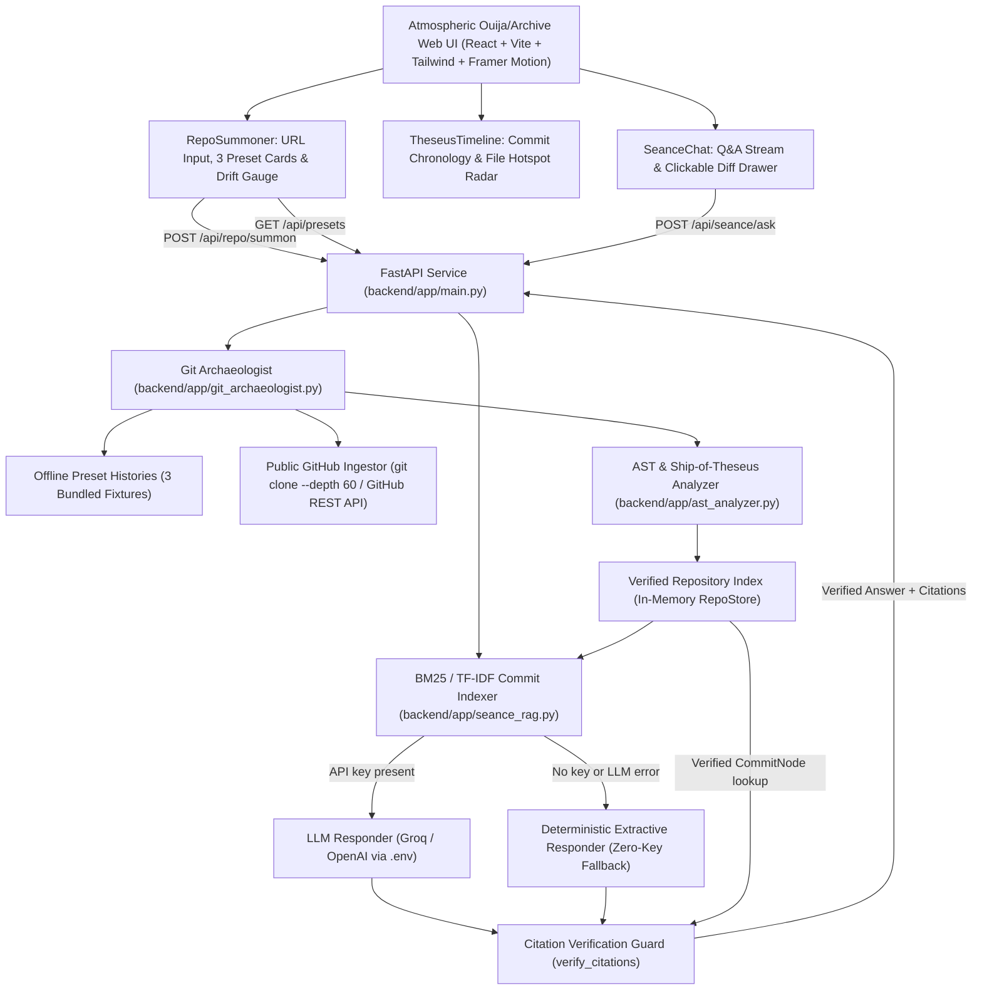

# Design Document — CodeSéance Core

## 1. Overview & Frankenstein Architecture

**CodeSéance** embodies the Kiroween **Frankenstein** category by stitching together two contrasting computational organisms across a strict verification boundary:

- **Organism A — Deterministic Git & AST Forensics (`git_archaeologist.py` + `ast_analyzer.py`):**
  Purely algorithmic ingestion of shallow Git histories (`<= 60` commits), file churn accounting, bug-fix classification, Python `ast` / JS-TS symbol extraction, and mathematical **Ship-of-Theseus** mutation scoring.
- **Organism B — Grounded Conversational Séance Engine (`seance_rag.py`):**
  A natural-language archivist persona powered by BM25/TF-IDF retrieval over commit records and diffs, speaking through either a configured LLM (`GROQ_API_KEY` / `OPENAI_API_KEY`) or a zero-dependency deterministic extractive synthesizer.
- **The Suture — Citation Verification Guard (`verify_citations`):**
  No LLM output is trusted on its own. Every cited commit hash is cross-checked against the repository's immutable Verified Commit Index, stripping hallucinations and hydrating `short_hash`, `date`, `author`, `file_path`, and `diff_snippet` exclusively from recorded `CommitNode` objects.

---

## 2. System Architecture

---

## 3. Data Models (`backend/app/models.py`)

All contracts use **Pydantic v2** models shared across ingestion, analysis, RAG, and FastAPI endpoints:

| Model | Key Fields & Constraints |
|---|---|
| `FileDiff` | `file_path: str`, `status: Literal["added", "modified", "deleted", "renamed"]`, `additions: int >= 0`, `deletions: int >= 0`, `diff_snippet: str` (capped `<= 2000` chars), `symbols: list[str]` |
| `CommitNode` | `commit_hash: str`, `short_hash: str`, `author: str`, `date: str` (ISO-8601), `message: str`, `files_changed: list[str]`, `additions: int >= 0`, `deletions: int >= 0`, `is_bugfix: bool`, `diffs: list[FileDiff]` |
| `FileHotspot` | `file_path: str`, `commit_count: int >= 1`, `bugfix_count: int >= 0`, `total_churn: int >= 0`, `drift_score: float` in `[0.0, 100.0]`, `hotspot_score: float >= 0.0`, `symbols: list[str]`, `last_modified: str` |
| `PresetRepoInfo` | `preset_id: str`, `name: str`, `tagline: str`, `description: str`, `language: str`, `commit_count: int`, `estimated_drift: float`, `sample_questions: list[str]` |
| `RepoSummary` | `repo_id: str`, `name: str`, `source_type: Literal["preset", "github"]`, `source_url: str \| None`, `total_commits: int` (`<= 60`), `genesis_date: str`, `latest_date: str`, `theseus_drift_score: float` in `[0.0, 100.0]`, `drift_verdict: str`, `commits: list[CommitNode]`, `hotspots: list[FileHotspot]`, `languages: dict[str, int]` |
| `Citation` | `commit_hash: str`, `short_hash: str`, `date: str`, `author: str`, `file_path: str`, `commit_message: str`, `diff_snippet: str`, `relevance_score: float` |
| `SummonRequest` | `repo_url: str \| None = None`, `preset_id: str \| None = None` (validated so at least one is non-empty) |
| `SeanceAskRequest` | `repo_id: str`, `question: str` (non-whitespace `min_length=1`) |
| `SeanceAskResponse` | `repo_id: str`, `question: str`, `answer: str`, `citations: list[Citation]`, `mode: Literal["llm", "extractive"]`, `retrieved_commit_count: int` |
| `HealthResponse` | `status: str`, `llm_configured: bool`, `llm_provider: str`, `presets_available: int`, `summoned_repos_cached: int` |

---

## 4. Component Design Details

### 4.1 Git Archaeologist (`backend/app/git_archaeologist.py`)

- **Constants:**
  - `MAX_COMMITS = 60`
  - `MAX_DIFF_CHARS = 2000`
  - `MAX_DIFF_FILES_PER_COMMIT = 10`
- **3 Offline Bundled Preset Repositories:**
  1. `legacy-billing-monolith` (**Chronos Billing Engine**, Python/FastAPI):
     14 rich commits tracing a fintech ledger from naive `float` invoicing to `Decimal` arithmetic, a double-charge idempotency hotfix, raw SQL to parameterized repository migration, webhook signature verification, and removal of a premature RabbitMQ microservice split. High drift (~75–85%).
  2. `phoenix-auth-gateway` (**Specter Auth Gateway**, TypeScript/Python):
     12 commits migrating from MD5 password hashing + stateful cookies through stateless HS256 JWTs, a critical session-fixation vulnerability hotfix, CORS wildcard rollback, and OAuth2 PKCE + refresh token rotation. Moderate-high drift (~60–75%).
  3. `haunted-cache-daemon` (**Wraith Cache Daemon**, Python):
     10 commits evolving an LRU/TTL daemon: thundering-herd lock protection, eviction race-condition patch, memory-pressure slab tuning, while keeping the core wire protocol module untouched since genesis. Moderate drift (~35–55%).
- **Public GitHub URL Validation & Ingestion:**
  - Strict regex validation against `^https://github\.com/([A-Za-z0-9_.-]+)/([A-Za-z0-9_.-]+?)(?:\.git)?/?$`, blocking traversal (`..`), credentials (`@`), non-HTTPS schemes, and shell characters.
  - **Primary Strategy (Shallow Git Clone):** Uses `tempfile.TemporaryDirectory()` and `subprocess.run(["git", "clone", "--depth", str(MAX_COMMITS), "--single-branch", "--no-tags", "--", clean_url, str(repo_dir)], shell=False, timeout=45)` followed by `git log -n 60 --date=iso-strict --numstat` and bounded per-commit `git show` hunks.
  - **Fallback Strategy (GitHub REST API):** When `git` clone fails or times out, fetches up to 60 commits from `https://api.github.com/repos/{owner}/{repo}/commits?per_page=60` and inspects commit details/patches for top recent commits via `httpx` (honoring optional `GITHUB_TOKEN` if provided).
- **Verified Commit Store:** Thread-safe or ordered in-memory `REPO_STORE` (bounded LRU capacity, e.g., max 64 summoned repositories) keyed by deterministic `repo_id` (`preset:<preset_id>` or `gh:<owner>/<repo>`).

### 4.2 AST & Ship-of-Theseus Analyzer (`backend/app/ast_analyzer.py`)

- **Chronological Ordering:** Commits are processed from **genesis (oldest)** to **latest (newest)** when simulating structural evolution, and stored/returned in reverse chronological (`newest -> oldest`) or clearly ordered timeline order (with `genesis_date` and `latest_date` derived accurately from timestamps).
- **Ship-of-Theseus Per-File Drift Score (`[0.0, 100.0]`):**
  - Track each file's `initial_lines` (from its genesis commit `additions`, or `max(1, ...)` if introduced there), `post_additions`, `post_deletions`, `created_in_genesis`, and `was_deleted`:
    - If `!created_in_genesis` (introduced after genesis): `drift = 100.0`.
    - If `was_deleted`: `drift = 100.0`.
    - If `post_additions == 0 and post_deletions == 0`: `drift = 0.0`.
    - Otherwise, with `genesis_size = max(initial_lines, 1)`:
      - `deletion_ratio = min(1.0, post_deletions / genesis_size)`
      - `addition_ratio = post_additions / (genesis_size + post_additions)`
      - `drift = clamp(0.0, 100.0, round((0.65 * deletion_ratio + 0.35 * addition_ratio) * 100.0, 2))`
- **Repository-Wide `theseus_drift_score` (`[0.0, 100.0]`):**
  - If `len(commits) <= 1` or no files tracked: `0.0`.
  - Otherwise, weighted mean of per-file `drift_score` weighted by `max(initial_lines + post_additions + post_deletions, 1)`, clamped strictly to `[0.0, 100.0]`.
  - **Drift Verdict Tiers:**
    - `[0.0, 20.0)` -> `"Preserved Relic"`
    - `[20.0, 50.0)` -> `"Evolving Vessel"`
    - `[50.0, 80.0)` -> `"Mutated Architecture"`
    - `[80.0, 100.0]` -> `"Complete Ship of Theseus"`
- **Bug-Fix Classification & File Hotspot Ranking:**
  - Case-insensitive word-boundary/keyword regex matching commit messages (`fix`, `bug`, `hotfix`, `patch`, `race`, `crash`, `regression`, `revert`, `leak`, `deadlock`, `security`, `vulnerability`, `cve`).
  - Per-file score: `hotspot_score = round(commit_count * 1.5 + bugfix_count * 3.0 + math.log1p(total_churn), 2)`.
  - Sorted descending by `(hotspot_score, commit_count, total_churn)` and ascending by `file_path` for determinism.
- **Symbol Extraction:**
  - `.py` files: strip `+`/`-` diff markers from added/modified hunk lines, attempt `ast.parse` to collect `FunctionDef`, `AsyncFunctionDef`, and `ClassDef` names; fall back to regex `(?:async\s+)?def\s+([A-Za-z_]\w*)|class\s+([A-Za-z_]\w*)` on partial hunks.
  - `.js`, `.jsx`, `.ts`, `.tsx` files: extract `function`, `class`, `interface`, `type`, and exported `const <Name> = (` declarations via regex.

### 4.3 Grounded Séance Engine (`backend/app/seance_rag.py`)

- **Retrieval Index (Pure Python BM25):**
  - Tokenizes each `CommitNode` document combining `message` (weighted 3x), `files_changed` (2x), extracted `symbols` (2x), `author`, and `diff_snippet` lines.
  - Computes BM25 scores (`k1 = 1.5`, `b = 0.75`) for the user query, applying a light boost when queries ask about "bug", "fragile", "hotspot", "error", or "fix" to `is_bugfix` commits, or "origin"/"genesis"/"why started" to earliest commits.
  - Selects top `k = 5` non-zero (or top fallback) verified `CommitNode` records.
- **Provider Resolution & Extractive Fallback:**
  - Checks `GROQ_API_KEY` (calling Groq's OpenAI-compatible `https://api.groq.com/openai/v1/chat/completions`, default model `llama-3.3-70b-versatile`) first, else `OPENAI_API_KEY` (`https://api.openai.com/v1/chat/completions`, default model `gpt-4o-mini`).
  - Instructs the LLM to adopt the *CodeSéance Forensic Archivist* persona and return structured JSON containing `{ "answer": str, "cited_hashes": list[str] }` grounded *only* in the provided commit packets.
  - If neither key is set, or if the API request fails/times out/returns invalid JSON, executes `build_extractive_answer(question, ranked_commits, repo_summary)` returning `mode="extractive"`.
- **Mandatory Citation Verification Guard (`verify_citations`):**
  - Maps `commit_map = {c.commit_hash: c for c in repo.commits}` and `short_map = {c.short_hash: c for c in repo.commits}`.
  - Filters out any hash not found in `commit_map` or `short_map`.
  - If the LLM returned an answer referencing zero valid hashes (or stripped hallucinations left zero citations), attaches the top verified BM25 matches (if any) or clearly marks zero matching citations if the repo has zero commits.
  - Constructs each `Citation` solely from the verified `CommitNode` and selects a real `file_path` present in `commit.files_changed` (preferring the file whose diff/path best matches the query, or `"(commit-level)"` if `files_changed` is empty) and its exact `diff_snippet`.

### 4.4 API Surface (`backend/app/main.py`)

- `GET /api/health` -> `HealthResponse`
- `GET /api/presets` -> `list[PresetRepoInfo]`
- `POST /api/repo/summon` -> `RepoSummary`
- `POST /api/seance/ask` -> `SeanceAskResponse`
- CORS middleware allowing `http://localhost:5173`, `http://127.0.0.1:5173`, and comma-separated `FRONTEND_ORIGINS` (plus `*.vercel.app` regex if configured).

### 4.5 Atmospheric Frontend (`frontend/`)

- **Visual Theme:** Deep obsidian/void surfaces (`#08090d`, `#0f1219`), ectoplasmic teal (`#2dd4bf`), arcane amber (`#f59e0b`), and crimson hotspot accents (`#f43f5e`) with crisp monospace commit badges (`JetBrains Mono` / `Fira Code` fallback) and editorial headers.
- **Layout:**
  - `RepoSummoner.tsx`: Top bar with GitHub URL input + Summon button + 3 instant preset cards + animated SVG **Ship-of-Theseus Drift Gauge** (`0–100% Rewritten Since Genesis`).
  - `TheseusTimeline.tsx`: Left pane combining a clickable **File Hotspot Radar** (filter timeline by file) and **Interactive Commit Chronology** with author, timestamp, `+add/-del` churn bars, and bug-fix spectral tags.
  - `SeanceChat.tsx`: Right pane with prompt suggestion chips, `LLM` / `Extractive` mode badge, progressive message reveal, clickable commit hash pills (`[a1b2c3d]`) that open a **Diff Inspection Modal/Drawer** displaying the raw verified diff snippet and commit metadata.

---

## 5. Correctness Properties

These formal invariants bridge the specification and Hypothesis property-based tests (`backend/tests/test_citation_properties.py`):

1. **Property 1 — Citation Hash Integrity:**
   For ANY generated `RepoSummary` and ANY natural-language query (including adversarial prompts or mock LLM outputs injecting fabricated SHA-1 hashes), every returned `Citation.commit_hash` **MUST** belong to `{c.commit_hash for c in repo.commits}`, and its `short_hash`, `date`, `author`, and `commit_message` **MUST** equal the corresponding `CommitNode` record.
2. **Property 2 — Citation File-Path Grounding:**
   For ANY returned `Citation`, its `file_path` **MUST** be a member of the cited commit's `files_changed` list (or `"(commit-level)"` strictly when `files_changed` is empty).
3. **Property 3 — Ship-of-Theseus Drift Boundedness:**
   For ANY commit graph (0 commits, 1 commit, all files deleted, zero-line files, or extreme positive/negative churn), `repo.theseus_drift_score` and every `FileHotspot.drift_score` **MUST** be finite floats satisfying `0.0 <= score <= 100.0`.
4. **Property 4 — Shallow History Cap:**
   Every ingested repository (whether preset, shallow clone, or API fallback) **MUST** satisfy `len(repo.commits) <= 60` and `repo.total_commits == len(repo.commits)`.
5. **Property 5 — Zero-Key Deterministic Extractive Fallback:**
   When `GROQ_API_KEY` and `OPENAI_API_KEY` are unset, `seance_rag.ask_seance(...)` **MUST** perform zero external HTTP requests, always return `mode == "extractive"`, a non-empty `answer`, and strictly verified citations.
6. **Property 6 — File Hotspot Monotonicity & Non-Negativity:**
   Every `FileHotspot` **MUST** satisfy `commit_count >= 1`, `0 <= bugfix_count <= commit_count`, `total_churn >= 0`, `hotspot_score >= 0.0`, and `hotspots[i].hotspot_score >= hotspots[i+1].hotspot_score` for all `i`.

---

## 6. Error Handling & Testing Strategy

- **Validation & HTTP Status Mapping:**
  - Malformed summon payload / invalid URL / empty question -> `422` / `400`
  - Unknown `preset_id` or unknown `repo_id` -> `404`
  - Upstream GitHub timeout / unavailable public repo -> `502` with clean retry guidance
- **Automated Testing:**
  - `backend/tests/test_archaeologist.py`: Unit tests covering all 3 offline presets, GitHub URL validation (including SSRF/command-injection rejection), shallow commit capping, AST symbol extraction, Ship-of-Theseus edge cases, FastAPI endpoint roundtrips via `TestClient`, and LLM fallback behavior with monkeypatched errors.
  - `backend/tests/test_citation_properties.py`: Hypothesis property-based tests generating arbitrary commit DAGs, file churn profiles, queries, and adversarial fake-hash LLM responses to prove Properties 1–6 across randomized inputs.
  - `.kiro/hooks/test-on-save.kiro.hook`: Automatically runs `pytest backend/tests -v` whenever any `backend/**/*.py` file is modified.
