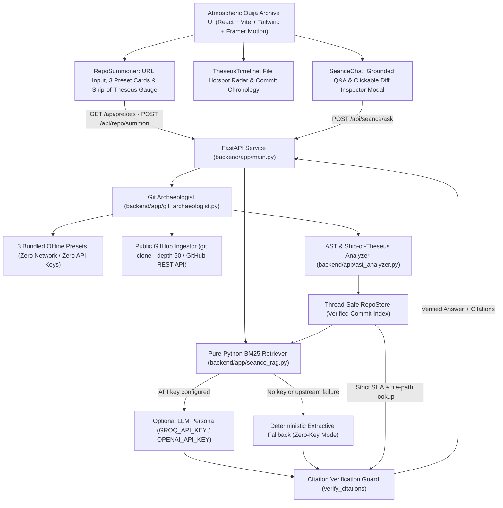

# CodeSéance

> *"Summoning the ghosts of past commits to explain why legacy code exists."*

Built for the **Kiroween 2026 Hackathon** (**Frankenstein** Category) · Licensed under **MIT**

---

## The Frankenstein Premise

Legacy codebases rarely explain *why* they look strange, defensive, or over-engineered. **CodeSéance** stitches together two distinct engineering worlds across a strict cryptographic-grade citation boundary:

1. **Deterministic Git Commit Archaeology & AST Structural Diffing** (`backend/app/git_archaeologist.py` + `backend/app/ast_analyzer.py`):
   Ingests up to 60 recent commits, tracks churn and bug-fix hotspots, extracts Python `ast` and TypeScript/JavaScript symbols, and computes a **Ship-of-Theseus Drift Score** (`0%` = untouched genesis code, `100%` = completely rewritten or replaced).
2. **Grounded Conversational AI Persona** (`backend/app/seance_rag.py`):
   Indexes commit messages, file paths, extracted symbols, authors, and diff hunks via pure-Python BM25 retrieval so developers can interrogate an archive in plain English—backed by **zero-hallucination citation verification** (`verify_citations`), where every cited commit hash opens the exact verified diff snippet.

---

## System Architecture



---

## Ship-of-Theseus Drift & Hotspot Radar

For every tracked file, `ast_analyzer.py` walks the chronological commit history from genesis (`idx == 0`) to latest:

- **Untouched Genesis Relic (`0.0%` drift):** Created in the genesis commit with zero subsequent additions, deletions, or removals.
- **Replaced / Post-Genesis Code (`100.0%` drift):** Created strictly after the genesis commit or deleted/replaced after genesis.
- **Modified Genesis File:** Combines deletion proportion (`0.65 * min(1.0, post_deletions / genesis_size)`) and addition proportion (`0.35 * (post_additions / (genesis_size + post_additions))`), strictly clamped to `[0.0, 100.0]`.
- **Repository Verdict Tiers:**
  - `0.0% – 19.9%` → **Preserved Relic**
  - `20.0% – 49.9%` → **Evolving Vessel**
  - `50.0% – 79.9%` → **Mutated Architecture**
  - `80.0% – 100.0%` → **Complete Ship of Theseus**

File fragility hotspots rank files by `commit_count * 1.5 + bugfix_count * 3.0 + ln(1 + total_churn)` so developers immediately see which modules attract repeated emergency fixes.

---

## Zero-Friction Judge Demo (3 Bundled Offline Presets)

Judges can test CodeSéance instantaneously with **zero API keys** and **zero GitHub rate limits**:

| Preset ID | Display Name | Stack | Story & Forensic Highlights |
|---|---|---|---|
| `legacy-billing-monolith` | **Chronos Billing Engine** | Python | Float-to-`Decimal` rewrite, double-charge idempotency race hotfix, SQL injection fix, abandoned RabbitMQ `queue_worker.py` (`100%` drift), and untouched `billing/config.py` (`0%` relic). |
| `phoenix-auth-gateway` | **Specter Auth Gateway** | TypeScript | MD5 cookies → HS256 JWT → session-fixation hotfix → CORS credential fix → OAuth2 PKCE + refresh rotation, with `src/config/constants.ts` untouched (`0%` relic). |
| `haunted-cache-daemon` | **Wraith Cache Daemon** | Python | Concurrent `LRUCache` eviction race fix, singleflight thundering-herd lock, wall-clock to `time.monotonic` TTL fix, and untouched `wraith/protocol.py` (`0%` relic). |

When neither `GROQ_API_KEY` nor `OPENAI_API_KEY` is configured, `POST /api/seance/ask` automatically serves deterministic BM25-ranked extractive citations (`mode: "extractive"`).

---

## How `.kiro/` Drove the Build

CodeSéance was engineered spec-first with Kiro artifacts tracked directly in Git:

- **Steering ([`.kiro/steering/product-constraints.md`](.kiro/steering/product-constraints.md)):** Always-included constraints enforcing zero-hallucination citations, `MAX_COMMITS = 60`, bounded diff budgets (`2,000` chars / `40` lines, lockfiles/binaries omitted), zero-network offline presets, deterministic extractive fallback, `[0.0, 100.0]` drift bounds, and `shell=False` subprocess hygiene.
- **Specs ([`.kiro/specs/codeseance-core/`](.kiro/specs/codeseance-core/)):**
  - `requirements.md` — 6 EARS-formatted requirements with explicit acceptance criteria.
  - `design.md` — Architecture, Pydantic schemas, Ship-of-Theseus math, and 6 formal **Correctness Properties**.
  - `tasks.md` — Phased 5-task implementation checklist.
- **Agent Hook ([`.kiro/hooks/test-on-save.kiro.hook`](.kiro/hooks/test-on-save.kiro.hook)):** Automatically runs `pytest backend/tests -v` whenever any `backend/**/*.py` file is modified.
- **Property-Based Testing ([`backend/tests/test_citation_properties.py`](backend/tests/test_citation_properties.py)):** Uses **Hypothesis** to fuzz arbitrary commit graphs (0–75 commits), adversarial fake SHA-1 hashes, tampered metadata, and off-topic/zero-key queries. During development, Hypothesis caught a real `ValueError: source code string cannot contain null bytes` crash in `ast.parse()` when binary/null bytes appeared in diff snippets—immediately resolved in `extract_symbols()` by stripping `\x00` bytes and guarding AST parse errors.

---

## Quickstart (Local Development)

### 1. Start the FastAPI Backend

```bash
cd backend
python -m venv .venv
# Windows PowerShell: .\.venv\Scripts\Activate.ps1
# macOS/Linux: source .venv/bin/activate
pip install -r requirements.txt
# Optional: copy .env.example to .env if you want Groq/OpenAI LLM mode
uvicorn app.main:app --reload --port 8000
```

### 2. Start the React Frontend

```bash
cd frontend
npm install
npm run dev
```

Open `http://localhost:5173`. Vite proxies `/api/*` directly to `http://127.0.0.1:8000`.

### 3. Run the Test Suite (Unit + Property-Based Tests)

From the repository root:

```bash
pytest backend/tests -v
```

---

## API Endpoints

| Method & Path | Purpose |
|---|---|
| `GET /api/health` | Service readiness, active mode (`groq`, `openai`, or `extractive`), preset & cache counts. |
| `GET /api/presets` | Returns the 3 bundled offline demo preset repositories and sample questions. |
| `POST /api/repo/summon` | Accepts `{ "preset_id" }` or `{ "repo_url" }` and returns `RepoSummary` (commits, hotspots, drift score). |
| `POST /api/seance/ask` | Accepts `{ "repo_id", "question", "top_k?" }` and returns `{ "answer", "citations", "mode", "retrieved_commit_count" }`. |

---

## Deployment

- **Backend (Render):** Defined in [`render.yaml`](render.yaml) (`rootDir: backend`, `uvicorn app.main:app --host 0.0.0.0 --port $PORT`, health check `/api/health`). Set `FRONTEND_ORIGINS` to your deployed frontend URL and optionally `GROQ_API_KEY` / `OPENAI_API_KEY` / `GITHUB_TOKEN`.
- **Frontend (Vercel):** Defined in [`vercel.json`](vercel.json) (`outputDirectory: frontend/dist`). Set `VITE_API_BASE_URL` in Vercel to your deployed Render API URL (for example `https://codeseance-api.onrender.com`).

---

## Repository Structure

```text
codeseance/
├── .kiro/
│   ├── steering/product-constraints.md
│   ├── specs/codeseance-core/{requirements,design,tasks}.md
│   └── hooks/test-on-save.kiro.hook
├── backend/
│   ├── app/{__init__,main,models,git_archaeologist,ast_analyzer,seance_rag}.py
│   ├── tests/{test_archaeologist,test_citation_properties}.py
│   ├── requirements.txt
│   └── .env.example
├── frontend/
│   ├── src/components/{RepoSummoner,TheseusTimeline,SeanceChat}.tsx
│   ├── src/{App,api,main,types,index.css}.*
│   └── package.json
├── render.yaml
├── vercel.json
├── LICENSE
└── README.md
```

## License

MIT — see [LICENSE](LICENSE).
